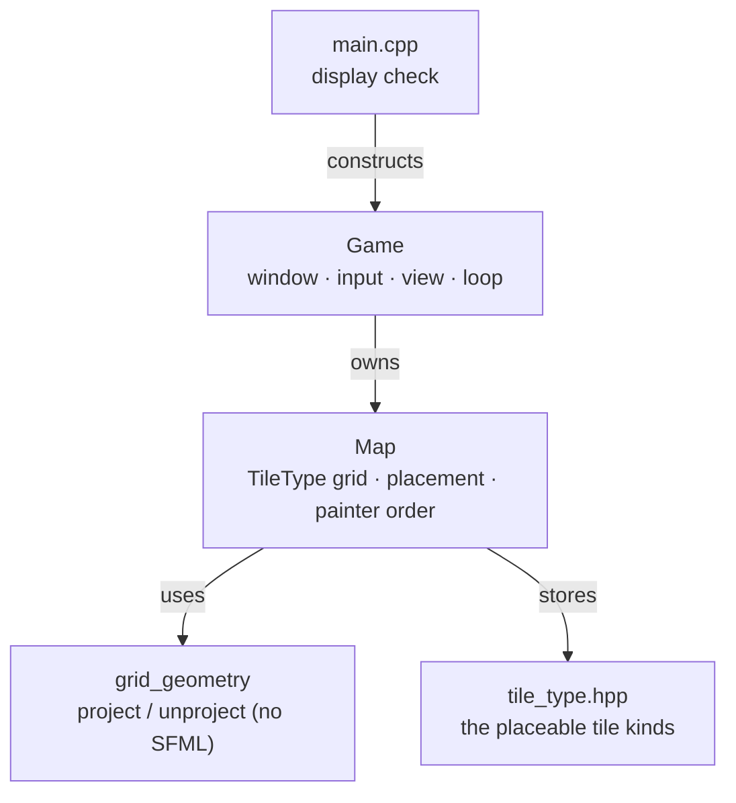

# IsometricSFMLgame

A small Diablo-style isometric map editor written in **C++20** with **SFML 3**.

Left click stamps the selected tile, right click clears a cell, `G`/`H` switch
between the three z levels, and `0`-`7` choose what to place. Tiles are drawn as
coloured isometric diamonds, so the editor needs no art files.

## How the pieces connect

`Game` owns the window and the map, and runs the loop. Solid arrows mean
ownership or a call.



## Requirements

| Dependency | Version | Notes |
|---|---|---|
| C++ compiler | C++20 | GCC 11+, Clang 14+, MSVC 19.30+ (VS 2022) |
| SFML | **3.1** (3.0 also works) | SFML 2.x will **not** compile: the code uses the SFML 3 API |
| CMake | 3.20+ | Optional, only for the CMake build |

## Building

### CMake

```bash
cmake -S . -B build -DCMAKE_BUILD_TYPE=Release -DCMAKE_PREFIX_PATH=/path/to/SFML-3.1.0
cmake --build build
./build/IsometricGame
```

`find_package(SFML 3 COMPONENTS Graphics Window System)` is used, so either
install SFML 3 system-wide or point `CMAKE_PREFIX_PATH` at an unpacked SDK. On
Windows the SFML DLLs are copied next to the executable automatically.

On Linux SFML also needs the X11/OpenGL/UDev development headers
(`libXrandr`, `libXi`, `libXcursor`, `libXfixes`, `libglvnd`, `udev`).

### Linux helper script (no root required)

`scripts/build-linux.sh` bootstraps everything and is safe to re-run:

```bash
./scripts/build-linux.sh            # Debug build + tests
./scripts/build-linux.sh --build-type Release --jobs 8
```

It extracts the missing Fedora `-devel` headers into a private sysroot, builds
SFML 3.1 into `~/.cache/isometric-sfml3` (override with `ISO_DEPS=...`) unless a
system SFML 3 is visible, then configures, builds and runs `ctest`.

The game needs a display. On a headless machine:

```bash
Xvfb :99 -screen 0 1920x1080x24 &
DISPLAY=:99 ./build/IsometricGame
```

### Visual Studio

Open `IsometricSFMLgame.sln`, select `x64` and build. The project reads the SFML
SDK location from `$(SFMLDir)`, which defaults to
`C:\ProgrammingProjects\SFML-3.1\SFML-3.1.0`; override it on the command line
with `/p:SFMLDir=...`.

### Tests

One headless test covers the isometric projection (no SFML, no display):

```bash
cmake -S . -B build -DISO_BUILD_GAME=OFF
cmake --build build
ctest --test-dir build --output-on-failure
```

## Controls

| Input | Action |
|---|---|
| `Escape` | Quit |
| `H` / `G` | Raise / lower the active z level |
| `0` | Select the eraser (left click also clears) |
| `1`–`7` | Grass, Forest, Water, Residential, Commercial, Industrial, Road |
| Left click | Place the selected tile on the active z level |
| Right click | Clear the clicked cell |
| Mouse move | Translucent preview of the placement |

## Project layout

```
IsometricSFMLgame.sln
CMakeLists.txt              CMake build (game + test)
scripts/build-linux.sh      Bootstraps SFML 3 + X11 headers, builds and tests
.vscode/                    IntelliSense setup using build/compile_commands.json
IsometricSFMLgame/          Visual Studio project
  src/
    main.cpp                Entry point
    core/                   Window, input and the frame loop
    map/                    Tile storage, drawing and projection math
tests/
  grid_geometry_test.cpp    Projection/unprojection checks
docs/
  ARCHITECTURE.md           How the pieces fit together
```

Include paths are rooted at `src/`, so headers are included as
`#include "map/map.hpp"`.

## Status / limitations

* Maps are not saved or loaded; the editor is a sandbox.
* Tiles are flat coloured diamonds; there is no texture or sprite pipeline.
* Map size, zoom and tile colours are compile-time constants.
