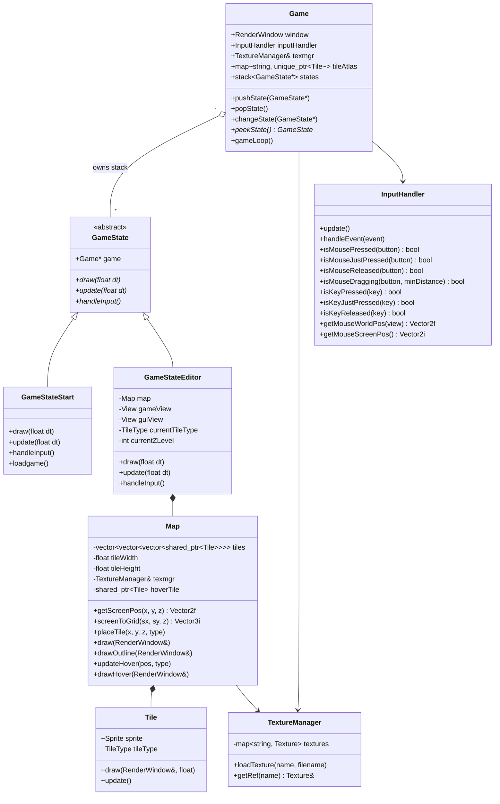
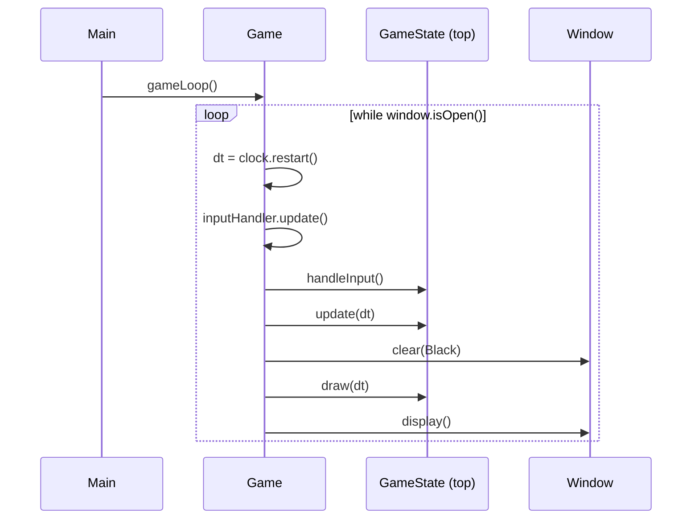
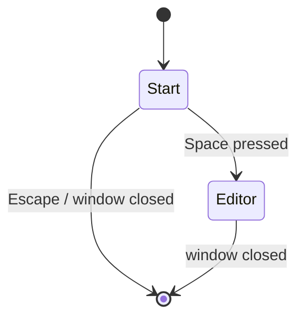
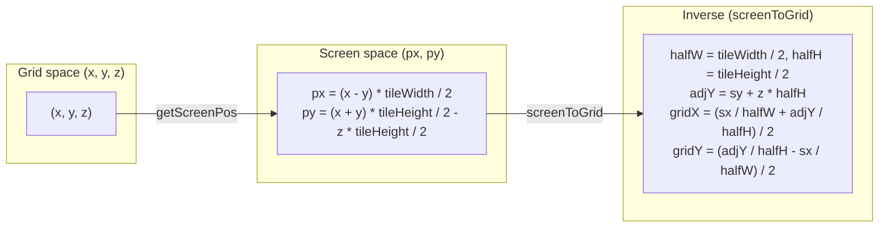
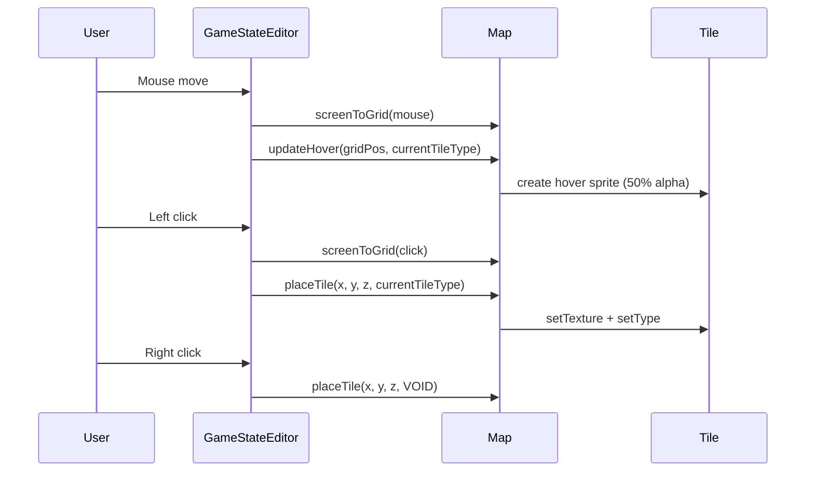

# IsometricSFMLgame — Architecture

This document describes how the game is structured, how the main loop drives
state transitions, and how isometric coordinates are converted to screen space.

## High-level overview

The game uses a **state stack** pattern. `Game` owns the window, the texture
manager, the tile atlas, and a stack of `GameState` objects. Each frame the
top state handles input, updates, and draws itself.

## Main loop

## State transitions

## Isometric coordinate transform

Grid coordinates `(x, y, z)` map to screen coordinates using a 2:1 isometric
projection. `tileWidth = 64`, `tileHeight = 32`.

## Tile placement flow

## Controls

| Key / Button | Action |
|---|---|
| `Space` (Start) | Enter editor |
| `Escape` (Start) | Quit |
| `H` | Raise Z-level |
| `G` | Lower Z-level |
| `1`–`7` | Select tile type (Grass, Forest, Water, Residential, Commercial, Industrial, Road) |
| Left click | Place selected tile |
| Right click | Clear tile (VOID) |
