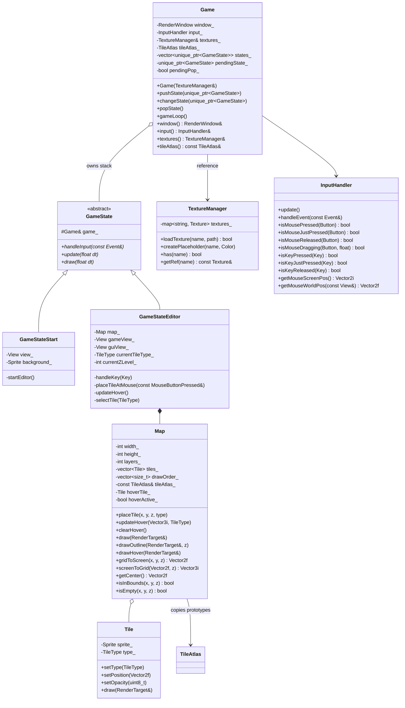
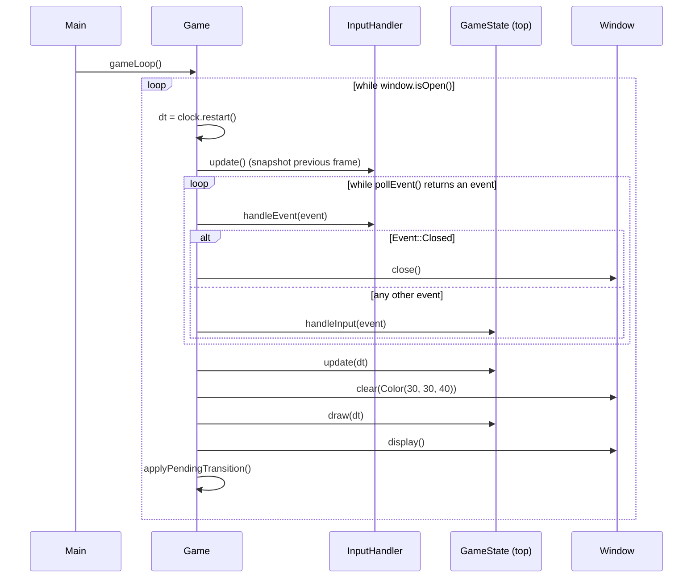
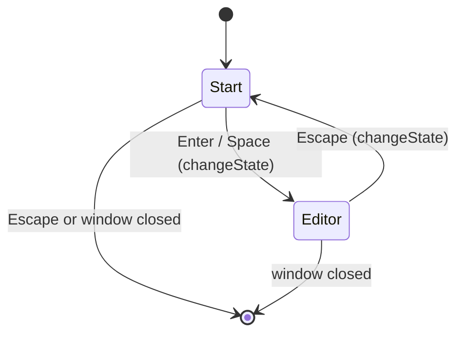
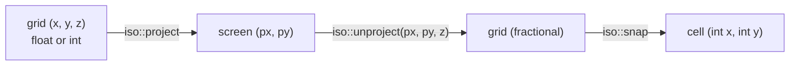
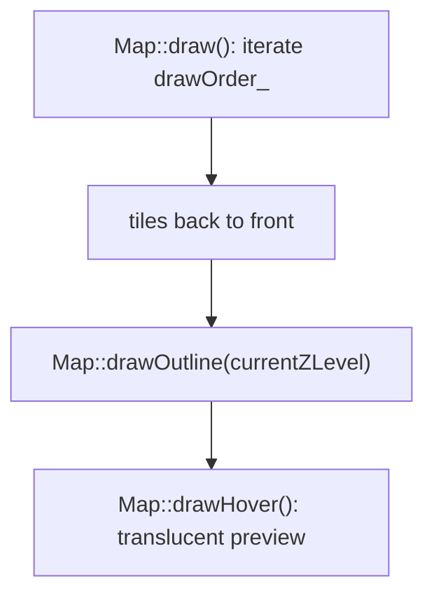
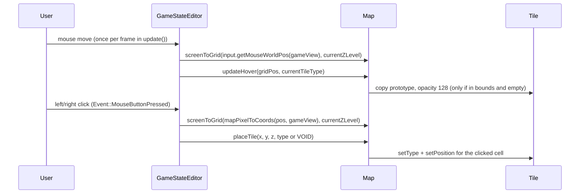

# IsometricSFMLgame — Architecture

How the game is put together: the folder layout, the frame loop, the state
stack, the isometric projection and the drawing order.

## Modules

| Folder | Responsibility |
|---|---|
| `src/core` | Game shell: window, frame loop, state stack, input polling, texture loading, asset path resolution, tunables (`constants.hpp`). |
| `src/states` | `GameState` interface plus the two screens (`GameStateStart`, `GameStateEditor`). |
| `src/map` | `Map` (layered tiles, hover preview, draw order), `Tile`, `TileAtlas`, `TileType`, and `grid_geometry.hpp` — the SFML-free projection math. |
| `src/ui` | Reusable widgets. Currently `Button`. |
| `src/animation` | Sprite-sheet helpers: `Animation` (frame range) and `AnimationHandler` (advances the visible frame). |
| `tests` | Header-only tests for the projection math. |

Headers are included relative to `src/` (for example `#include "map/tile.hpp"`),
so the include directory is `IsometricSFMLgame/src`.

## Object graph



`Game` owns the resources (`TextureManager` is created by `main` and passed by
reference; `TileAtlas` holds one prototype `Tile` per type). States only hold
references, which is why the atlas and the texture manager outlive every state.
`Map` copies its initial tiles from the atlas, so tiles can change type without
touching the prototypes.

## Frame loop



Events are polled in exactly one place (`Game::gameLoop`) and forwarded to the
top state, so a state never needs its own event loop and cannot miss or reorder
events.

## State transitions

Transitions are **deferred**: `changeState()` and `popState()` only record an
intent, and `Game::applyPendingTransition()` performs the swap after the frame
has finished drawing.



Why deferred matters: a state requests its own replacement from inside
`handleInput()` (for example `Escape` in the editor). Destroying it immediately
would leave the loop calling methods on a freed object. With the deferred queue
the old state stays alive until the frame is over, and only the *top* state is
replaced (`pushState()` additionally keeps the previous state running below).

## Isometric projection

The math lives in `map/grid_geometry.hpp` as pure functions, with no SFML
dependency, so it can be unit tested without a window.

Convention: **grid coordinates address the centre of a cell**, `z` counts up.

```
halfW = tileWidth / 2 = 32        halfH = tileHeight / 2 = 16

project(x, y, z)   -> px = (x - y) * halfW
                      py = (x + y) * halfH - z * halfH

unproject(px, py, z) -> a = px / halfW
                        b = (py + z * halfH) / halfH
                        x = (a + b) / 2
                        y = (b - a) / 2

snap(x, y)          -> (lround(x), lround(y))
```



Because the projection is linear and invertible, every screen point inside a
tile's diamond unprojects to grid coordinates within ±0.5 of that tile's
centre, so rounding picks the same cell the user visibly clicked. `Map` wraps
these helpers in `gridToScreen()` / `screenToGrid()`.

`snap()` uses `std::lround`, not a truncating cast, which is what makes clicks
left of or above the origin (negative coordinates) resolve to the correct cell.

The grid outline uses the same projection on half-offset coordinates: the line
for column edge `x` runs from `project(x - 0.5, -0.5, z)` to
`project(x - 0.5, height - 0.5, z)`. That places the lines exactly on the
diamond corners of the outermost tiles (regression-tested in
`tests/grid_geometry_test.cpp`).

## Drawing

`Map` builds its painter's-algorithm order once in its constructor (tiles never
move): cells are sorted by `x + y` and, within the same diagonal, by `z`, so
nearer and higher tiles are drawn last.



Two views are used by the editor:

* `gameView_` — same pixel size as the window, centred on the map centre and
  zoomed by `config::editorViewZoom`; used for all world-space drawing and for
  converting mouse pixels via `mapPixelToCoords(position, gameView_)`.
* `guiView_` — identity mapping in window pixels, installed *after* the world
  drawing; HUD elements (and the pixel-space `Button` hit tests) use it.

## Tile placement



`TileType::VOID` is a command, never a stored state: `Map::placeTile` turns it
into `TileType::EMPTY` with the empty sprite. Out-of-bounds clicks and hover
positions are ignored by `Map`.

## Input

`InputHandler` keeps `current`/`previous` arrays for mouse buttons and keys, so
both level-triggered (`isKeyPressed`) and edge-triggered (`isKeyJustPressed`)
queries work. Two details matter:

* `sf::Keyboard::Key::Unknown` is `-1` and `sf::Mouse::Button` is a scoped enum;
  every enum-to-index conversion goes through `isValidKey()` /
  `isValidMouseButton()` so an unknown value cannot index out of bounds.
* Drag detection stores the exact press position from
  `Event::MouseButtonPressed`, so `isMouseDragging()` reports pixel-accurate
  distances even when the cursor is moved quickly.

## Assets

`core/asset_path.cpp` resolves art files by trying, in order:

1. the path relative to the working directory,
2. the executable's directory and up to four parent directories (covers
   `x64/Debug/`, `build/`, `build/Debug/`, ...),
3. the original relative path (so the error message shows what was expected).

`Game::loadTextures()` logs a warning and calls
`TextureManager::createPlaceholder()` when a file is missing, generating a
solid-colour diamond tile, so the game is playable with an empty `assets/`
folder.

## Tests

`tests/grid_geometry_test.cpp` includes `map/grid_geometry.hpp` only and checks:

* project → unproject → snap round-trips for every cell and layer,
* clicks inside a diamond select that cell, clicks outside do not,
* neighbour spacing and the z offset,
* the grid outline corners coincide with the outer diamond vertices.

Build and run with
`cmake -S . -B build -DISO_BUILD_GAME=OFF && cmake --build build && ctest --test-dir build --output-on-failure`.

## Not wired up yet

`Button` and `AnimationHandler` are complete, self-contained components with no
dependencies on the rest of the game, but no state instantiates them yet. To use
them:

* add a `Button` member to a state, forward `Event::MouseButtonPressed` /
  `MouseButtonReleased` to `Button::handleEvent()`, set a callback with
  `setOnClick()`, and draw it after `window.setView(guiView_)`;
* give a `Tile` an `AnimationHandler`, call `update(dt)` each frame and pass
  `getBounds()` to the sprite's `setTextureRect()`.
